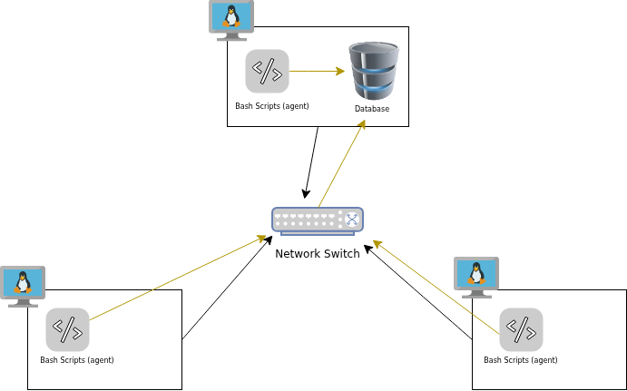

# Linux Cluster Monitoring Agent
## Introduction
The Linux Cluster Monitoring Agent records the hardware specifications and monitors
the resource usage (CPU, memory, disk) of multiple Linux nodes connected through a
network switch. It is built for the Jarvis Linux Cluster Administration (LCA) team,
who use the collected data to track each server's hardware and resource usage over time.

Each node runs Bash scripts that collect hardware details once at setup and resource
usage every minute through `crontab`. The data is stored in a PostgreSQL database
running in a Docker container.
## Quick Start

```bash
# 1. Create and start a PostgreSQL container
./scripts/psql_docker.sh create postgres password
./scripts/psql_docker.sh start

# 2. Create the database and tables
psql -h localhost -U postgres -c "CREATE DATABASE host_agent;"
psql -h localhost -U postgres -d host_agent -f sql/ddl.sql

# 3. Insert hardware specs (run once per node)
./scripts/host_info.sh localhost 5432 host_agent postgres password

# 4. Insert resource usage data (one-time test)
./scripts/host_usage.sh localhost 5432 host_agent postgres password

# 5. Collect usage data every minute with crontab
crontab -e
# Add this line, then save and exit:
* * * * * bash [path]/host_usage.sh localhost 5432 host_agent postgres password > /tmp/host_usage.log

# Check the crontab and the data
crontab -l
psql -h localhost -U postgres -d host_agent -c "SELECT * FROM host_usage;"
```
# Implementation

The project was built in the following steps:

1. **Set up PostgreSQL with Docker.** I wrote `psql_docker.sh` to create, start and stop
   a PostgreSQL container, so the database runs in an isolated environment without
   installing PostgreSQL directly on the host. The container uses a Docker volume so
   the data persists when the container is stopped or removed.

2. **Designed the database schema.** `ddl.sql` creates two tables in the `host_agent`
   database: `host_info` for each node's static hardware specifications and
   `host_usage` for its resource usage over time. `host_info.id` is an auto-incrementing
   primary key, and `host_usage.host_id` is a foreign key that references it, linking
   each usage record to the node it came from.

3. **Collected hardware specifications.** `host_info.sh` parses the output of `lscpu`
and `/proc/meminfo` to collect the hostname, CPU count, architecture,
   model, speed, L2 cache and total memory, timestamped  then inserts them into `host_info`. It runs
   once per node, since the hardware doesn't change.

4. **Collected resource usage.** `host_usage.sh` uses `vmstat` and `df` to collect free
   memory, CPU idle and kernel time, disk I/O and available disk space, then inserts a
   timestamped row into `host_usage`. The node's `host_id` is looked up from `host_info`
   by hostname.

5. **Automated data collection.** `crontab` runs `host_usage.sh` every minute on each
   node, so usage data builds up continuously without manual work.

6. **Tested and verified.** I checked each script by running it manually, inspecting the
   rows with `SELECT` queries, and confirming that cron added a new row every minute.
## Architecture and Design

## Script Descriptions

**`psql_docker.sh`**
Creates, starts or stops the PostgreSQL Docker container. `create` pulls the
PostgreSQL image and creates a container with the given username and password; it
exits with an error if the container already exists or if either argument is missing.
```bash
./scripts/psql_docker.sh create|start|stop [db_username] [db_password]

# Examples
./scripts/psql_docker.sh create postgres password
./scripts/psql_docker.sh start
./scripts/psql_docker.sh stop
```

**`host_info.sh`**
Collects the node's hardware specifications (hostname, CPU count, architecture, model,
speed, L2 cache and total memory) from `lscpu`, `/proc/cpuinfo` and `/proc/meminfo`,
then inserts them into the `host_info` table. It runs once per node, since the
hardware doesn't change.
```bash
./scripts/host_info.sh psql_host psql_port db_name psql_user psql_password

# Example
./scripts/host_info.sh localhost 5432 host_agent postgres password
```

**`host_usage.sh`**
Collects the node's current resource usage (free memory, CPU idle and kernel time,
disk I/O and available disk space) from `vmstat` and `df`, then inserts a timestamped
row into the `host_usage` table. It is run every minute by `crontab`.
```bash
./scripts/host_usage.sh psql_host psql_port db_name psql_user psql_password

# Example
./scripts/host_usage.sh localhost 5432 host_agent postgres password
```

**`crontab`**
Runs `host_usage.sh` every minute so usage data is collected automatically.
```bash
crontab -e
# Add this line:
* * * * * bash /home/centos/dev/linux_sql/scripts/host_usage.sh localhost 5432 host_agent postgres password > /tmp/host_usage.log
```

**`ddl.sql`**
Creates the `host_info` and `host_usage` tables in the `host_agent` database.
```bash
psql -h localhost -U postgres -d host_agent -f sql/ddl.sql
```
## Database and Tables

All data is stored in the `host_agent` PostgreSQL database, which has two tables.
Each node has one row in `host_info` and many rows in `host_usage` (one per minute),
linked by `host_usage.host_id` ? `host_info.id`.

### `host_info`
Stores each node's hardware specifications. One row per node.

| Column             | Type      | Description                                |
|--------------------|-----------|--------------------------------------------|
| `id`               | SERIAL    | Primary key, auto-incremented              |
| `hostname`         | VARCHAR   | Fully qualified hostname (unique)          |
| `cpu_number`       | INT2      | Number of CPU cores                        |
| `cpu_architecture` | VARCHAR   | CPU architecture (e.g. `x86_64`)           |
| `cpu_model`        | VARCHAR   | CPU model name                             |
| `cpu_mhz`          | FLOAT8    | CPU clock speed in MHz                     |
| `l2_cache`         | INT4      | L2 cache size in KB                        |
| `timestamp`        | TIMESTAMP | When the record was collected (UTC)        |
| `total_mem`        | INT4      | Total memory in KB                         |

### `host_usage`
Stores each node's resource usage over time. One row per node per minute.

| Column           | Type      | Description                                    |
|------------------|-----------|------------------------------------------------|
| `timestamp`      | TIMESTAMP | When the usage was recorded (UTC)              |
| `host_id`        | SERIAL    | Foreign key referencing `host_info.id`         |
| `memory_free`    | INT4      | Free memory in MB                              |
| `cpu_idle`       | INT2      | Percentage of time the CPU is idle             |
| `cpu_kernel`     | INT2      | Percentage of time the CPU runs kernel code    |
| `disk_io`        | INT4      | Number of disk I/O operations in progress      |
| `disk_available` | INT4      | Available disk space on the root directory, in MB |
## Test

All scripts were tested manually on the Jarvis Remote Desktop VM, with PostgreSQL
running in a Docker container.

- **`ddl.sql`:** Ran the file with `psql -f`, then checked with `\dt` and `\d <table>`
  that both tables were created with the correct columns, types and keys.
- **`psql_docker.sh`:** Tested `create`, `start` and `stop`, and checked the container
  state with `docker ps -a`.
- **`host_info.sh` / `host_usage.sh`:** Printed each collected value with `echo` and compared
  it with the raw output of `lscpu`, `vmstat` and `df`. Ran each script, then confirmed the
  inserted rows with `SELECT * FROM host_info;` and `SELECT * FROM host_usage;`.
- **Crontab:** Confirmed that a new row was added to `host_usage` every minute and that
  `/tmp/host_usage.log` showed no errors.

**Result:** All scripts work as expected. Testing caught two bugs, which were fixed:
the CPU speed came out empty because `lscpu` on the VM has no `CPU MHz` line (fixed by
reading `/proc/cpuinfo`), and a quoted `host_id` subquery caused a SQL syntax error
(fixed by removing the quotes).
## Deployment

The project is deployed with GitHub, Docker and crontab:

- **GitHub:** The source code (Bash scripts, SQL files and this README) is managed with
  Git and hosted on GitHub. Features were developed on separate branches following the
  GitFlow model and merged into `develop`, then into `main` (or `master`) for release.
- **Docker:** The PostgreSQL database runs in a Docker container created by
  `psql_docker.sh`, so it can be set up on any machine with Docker without installing
  PostgreSQL directly.
- **Crontab:** `host_info.sh` is run once on each node to register its hardware.
  `host_usage.sh` is scheduled with `crontab` to run every minute on each node, so
  usage data is collected automatically.

To deploy on a new node:
1. Clone the repository: `git clone <repo_url>`
2. Run `host_info.sh` once to register the node in `host_info`.
3. Add the `host_usage.sh` line to the node's crontab.
## Improvements

1. **Handle hardware updates.** `host_info.sh` currently runs only once, so the
   database doesn't notice if a node's hardware changes (for example, after a memory
   or CPU upgrade). The script could be run on a schedule or at boot, using
   `INSERT ... ON CONFLICT (hostname) DO UPDATE` to update the row instead of creating
   a duplicate.

2. **Detect failed nodes automatically.** If a node goes down, its `host_usage` rows
   simply stop appearing. A scheduled query or script could flag any node that hasn't
   reported in the last few minutes and alert the LCA team, for example by email or Slack.

3. **Manage data growth.** `host_usage` gains one row per node every minute, so it
   grows quickly across many nodes. A retention policy could aggregate old data
   (for example, into hourly averages) and delete raw rows older than a set period.
